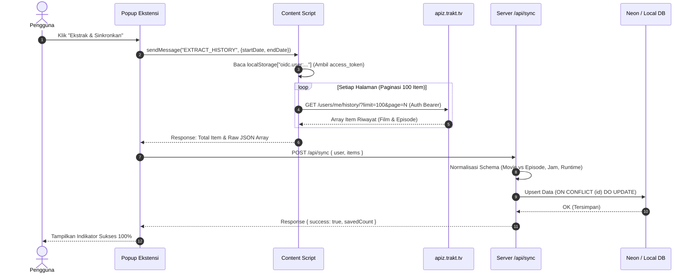

# 🏛️ System Architecture — TraktLens

**Versi**: `v0.1.0`  
**Arsitektur**: Monorepo (Chrome Extension Manifest V3 + Next.js App Router)  
**Database**: Neon Serverless PostgreSQL & Local JSON Storage Fallback  

---

## 1. Diagram Arsitektur Tingkat Tinggi

```mermaid
flowchart TD
    subgraph ClientBrowser["Browser Pengguna"]
        TabTrakt["app.trakt.tv<br/>(Sesi Login Pengguna)"]
        ExtContent["Content Script<br/>(Baca OIDC LocalStorage)"]
        ExtPopup["Extension Popup UI<br/>(Pilih Filter & Trigger)"]
        WebDashboard["TraktLens Web Dashboard<br/>(Next.js App Router)"]
    end

    subgraph TraktCloud["Trakt.tv Official Cloud"]
        TraktAPI["apiz.trakt.tv/users/me/history<br/>(Bearer Token Authorized)"]
    end

    subgraph VercelApp["Vercel Serverless Platform"]
        APISync["POST /api/sync<br/>(Parser & Upsert Handler)"]
        APIHistory["GET /api/history<br/>(Filter, Aggregator, Years)"]
    end

    subgraph StorageLayer["Data Storage Engine"]
        NeonDB[("Neon Serverless PostgreSQL<br/>(Primary Cloud)")]
        LocalJSON[("Local File Engine<br/>(.data/history.json)")]
    end

    TabTrakt -->|1. Ekstrak Token| ExtContent
    ExtPopup -->|2. Perintah Sync| ExtContent
    ExtContent -->|3. Fetch Paginated History| TraktAPI
    TraktAPI -->|4. Return JSON (watched_at, runtime)| ExtContent
    ExtContent -->|5. Forward JSON Payload| ExtPopup
    ExtPopup -->|6. POST /api/sync| APISync

    APISync -->|Kondisi DATABASE_URL Terisi| NeonDB
    APISync -->|Kondisi Offline / Lokal| LocalJSON

    WebDashboard -->|GET /api/history| APIHistory
    APIHistory -->|Query Filtered Data| NeonDB
    APIHistory -->|Read File Filtered Data| LocalJSON
    APIHistory -->|Return Aggregated Stats & Items| WebDashboard
```

---

## 2. Alur Data & Sequence Diagram

### 2.1 Alur Sinkronisasi Data (Ekstensi $\rightarrow$ Web)



---

## 3. Komponen Utama

### 3.1 Chrome Extension (`/extension`)
* **`manifest.json`**: Manifest V3 dengan host permissions `*://app.trakt.tv/*` dan `*://apiz.trakt.tv/*`.
* **`content.js`**:
  * Menembus *sandbox* halaman untuk membaca sesi OIDC resmi Trakt yang tersimpan di `localStorage`.
  * Memanggil API resmi Trakt dengan menyertakan header `Authorization: Bearer <token>`, `trakt-api-key`, dan `trakt-api-version: 2`.
  * Melakukan *auto-batching* paginasi dengan jeda ramah rate-limit (200ms per halaman).
* **`popup.js` & `popup.html`**:
  * Menangani antarmuka mini pengguna, pemilihan filter tanggal, konfigurasi target endpoint, dan indikator persentase loading.

### 3.2 Web Dashboard & API (`/web`)
* **Next.js 15 (App Router)**:
  * Serverless endpoints (`route.ts`) yang berjalan optimal di Vercel Functions.
  * Server-rendered & Client-hydrated UI untuk performa pemuatan instan.
* **API Endpoints**:
  * `POST /api/sync`: Menerima bulk upload dari ekstensi, mendukung CORS wildcard agar ekstensi bebas mengirim data tanpa error preflight.
  * `GET /api/history`: Mengembalikan data terfilter, kalkulasi metrik agregat, dan daftar `availableYears` dinamis.

---

## 4. Dual-Storage Engine Pattern

TraktLens mengadopsi pola arsitektur **Zero-Config Dual Storage**:
1. **Cloud Mode (Neon PostgreSQL)**:
   * Terdeteksi otomatis ketika variabel `process.env.DATABASE_URL` didefinisikan.
   * Menggunakan `@neondatabase/serverless` via HTTP/WebSockets, kompatibel dengan batas koneksi serverless di Vercel.
   * Skema database otomatis terinisialisasi (`CREATE TABLE IF NOT EXISTS`) pada request pertama.
2. **Local Fallback Mode (`.data/history.json`)**:
   * Aktif secara otomatis jika `DATABASE_URL` belum diset.
   * Menyimpan data langsung ke file JSON lokal di direktori server.
   * Menjamin bahwa pengguna dapat langsung menguji aplikasi secara offline tanpa perlu menginstall software database lokal.

---

## 5. Pertimbangan Keamanan & Skalabilitas

* **Keamanan Token**: Ekstensi tidak pernah menyimpan token Trakt ke storage permanen pihak ketiga. Token dibaca *on-demand* dari sesi aktif dan langsung digunakan untuk mengambil riwayat milik pengguna sendiri.
* **Idempotensi Sinkronisasi**: Menggunakan ID unik Trakt (`history_id`) sebagai Primary Key. Menyinkronkan ulang data yang sama tidak akan menyebabkan duplikasi data pada metrik.
* **CORS & Network Routing**: Endpoint `/api/sync` memiliki handler `OPTIONS` eksplisit dengan header `Access-Control-Allow-Origin: *` dan `Access-Control-Allow-Headers: Content-Type` untuk kompatibilitas lintas origin browser extension.
